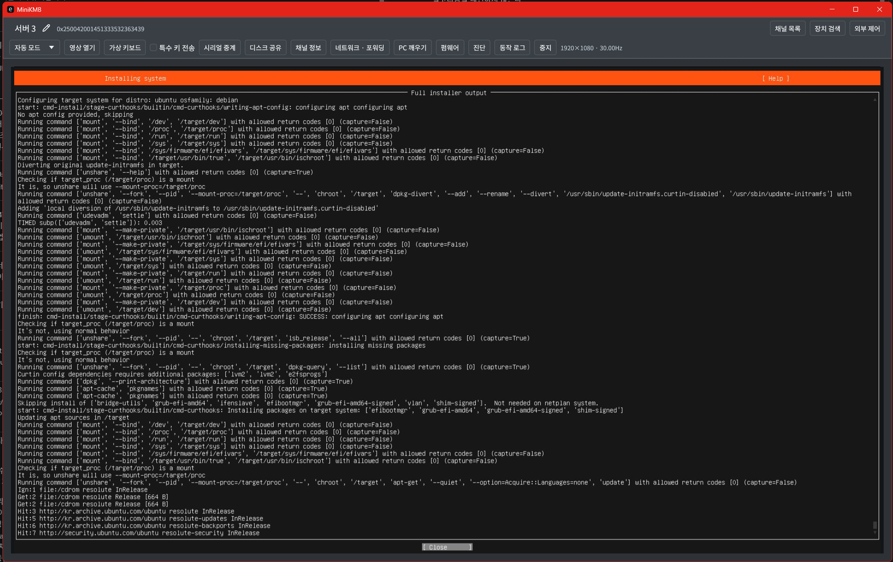
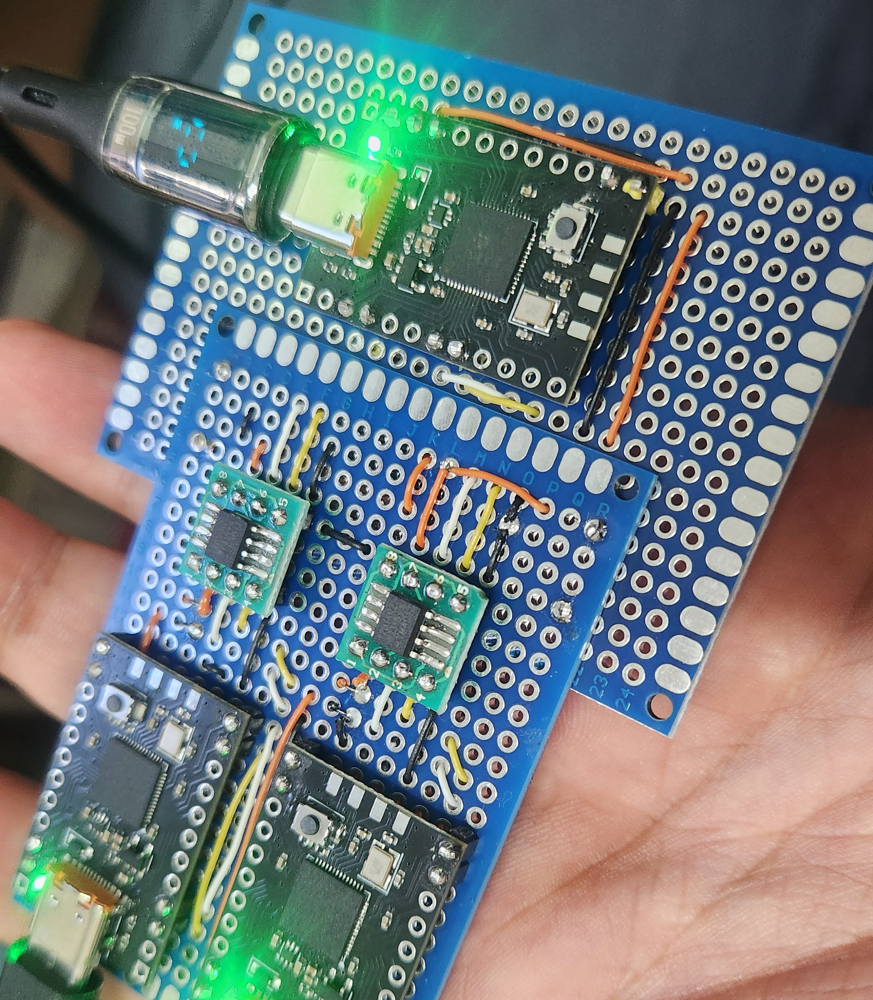
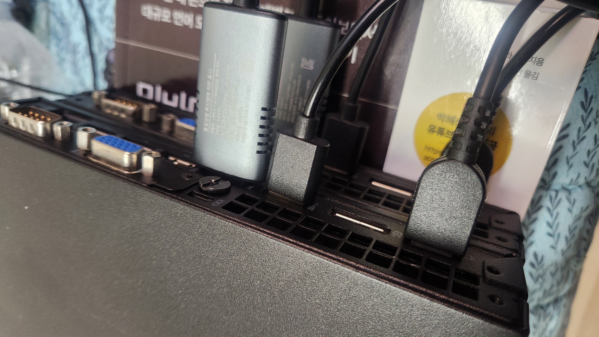
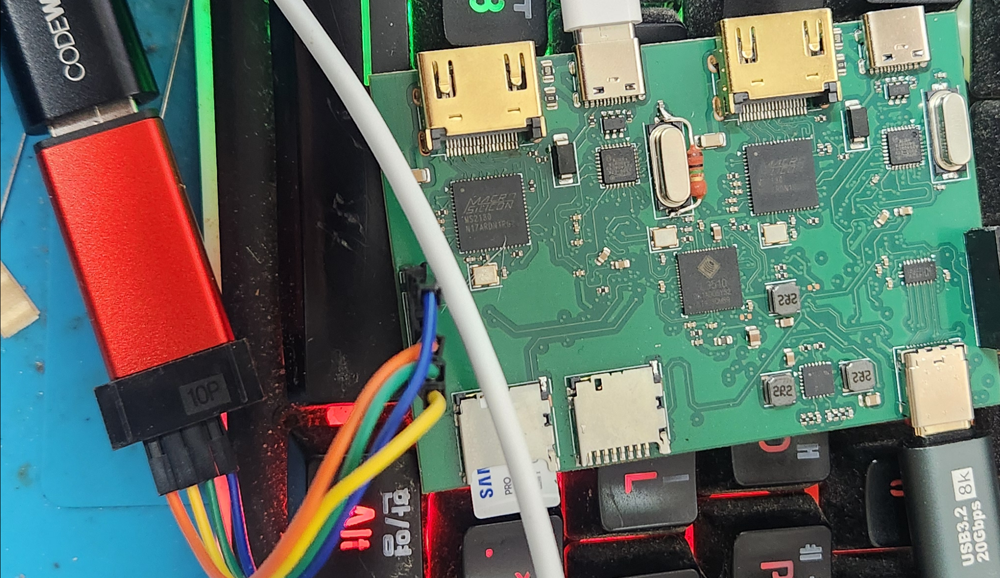
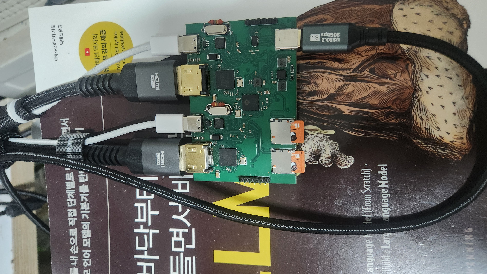
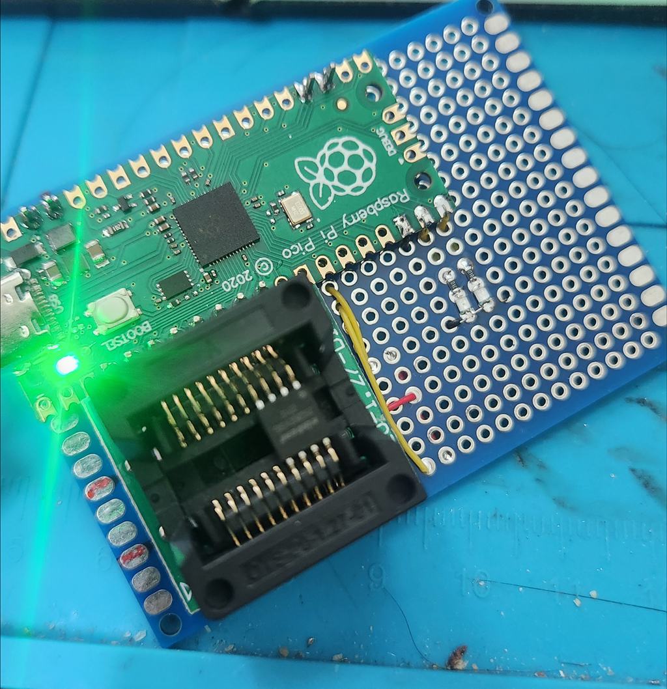
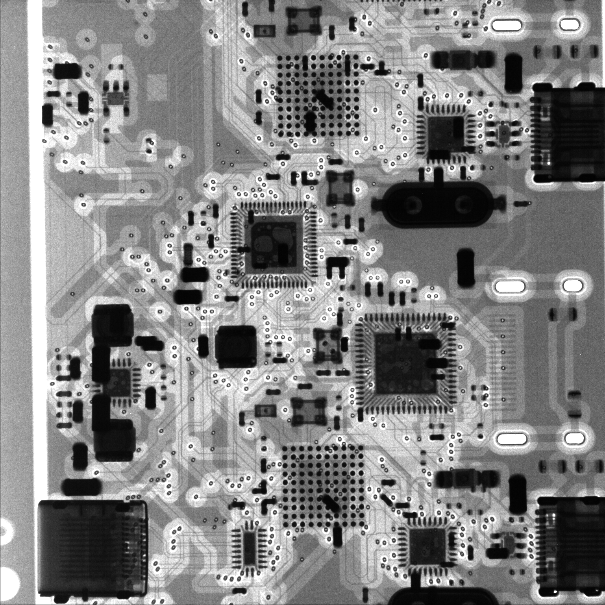
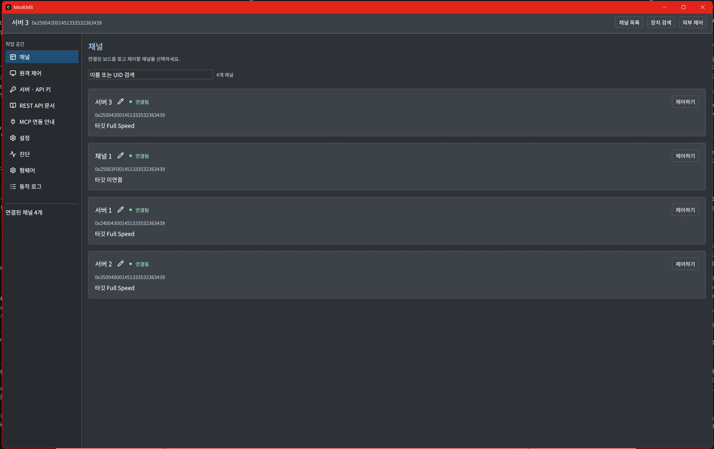
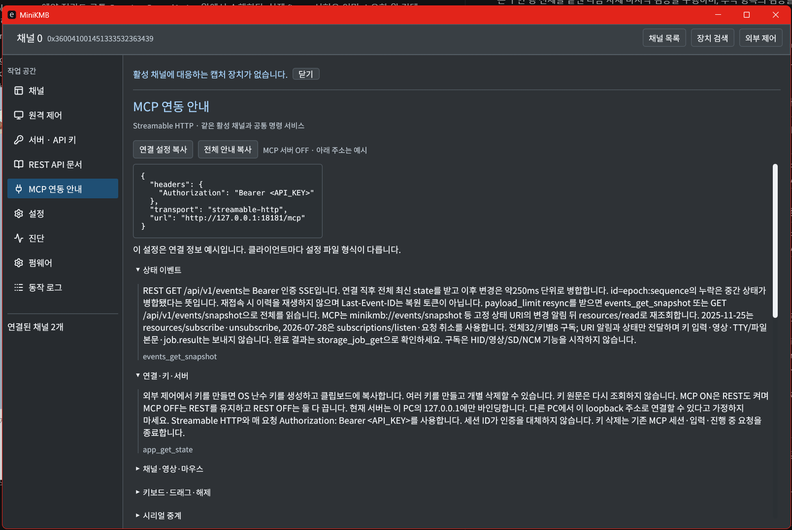

# MiniKMB

[한국어](README.md) · [English](README.en.md)

MiniKMB is a USB KVM project built to operate two mini PCs from one management PC. It combines HDMI video, keyboard and absolute mouse control, serial access, virtual disks and networking. It started as a hand-wired RP2040 prototype and evolved into a custom STM32H7 board and a Rust desktop app.

[Windows app and firmware](https://github.com/jay94ks/minikmb/releases) · [Build guide](docs/BUILDING.en.md) · [Hardware](docs/HARDWARE.en.md) · [References](#references)

## Features

- Two channels per board, with multiple boards managed in one app. The fixed USB hub port mapping automatically pairs each MCU with its MS2130. The app queries the MCU and uses its UID as the channel identifier.
- Channel names, drag-to-reorder channel cards, video mode selection and one active video/control channel.
- Physical and virtual keyboards, special keys, absolute mouse movement, clicks, dragging and scrolling.
- SD storage for ISO/UDF installation media and FAT32, exFAT and EXT4 disk images. Manage optical drives, writable virtual disks, folder delivery, uploads, image creation and formatting.
- CDC serial, NCM emulation, host internet/LAN sharing, port forwarding and a target-side port scanner.
- STM32 programming through ST-Link/SWD and MS2130 ROM programming through the RP2040 SPI Writer. Programming a new board does not require an active channel or a previously registered MCU UID.
- Built-in REST documentation and MCP setup guidance. Create and individually revoke multiple API keys. Channel information, image capture, keyboard/mouse, TTY, MSC and NCM share one command service.

There is **one active channel across GUI, REST and MCP**. Only channel selection takes a UID; ordinary controls use the active channel. Mouse API coordinates are capture-frame pixels, which the app converts to HID absolute coordinates. Enabling MCP also enables REST; REST can run alone. Large files are uploaded to the REST endpoint supplied by MCP.

## Getting started

1. Download the Windows x64 ZIP from [Releases](https://github.com/jay94ks/minikmb/releases) and extract it into a new directory. Keep `tools/`, `firmware/` and the license files together, then run `minikmb-native.exe`.
2. Connect management USB **J9** to the management PC. Target 0 uses **J1 HDMI + J3 USB**; target 1 uses **J2 HDMI + J4 USB**. J7/J8 hold the corresponding microSD cards.
3. Choose **Control** for a channel. Only one video stream is opened at a time, even with multiple boards connected.
4. Enable disk sharing, serial or networking as needed. REST/MCP and networking start OFF.

The preview targets Windows 10/11 x64 with DirectX 12 and Media Foundation. The Visual C++ v14 x64 Runtime may be needed. Creating filesystems in new disk images uses WSL `mkfs`/`fsck` tools. Running the app itself does not require Rust, Node.js or Python.

The bundled firmware is **STM32 v1.0 / FS-HID r63**, while the native app package identifies itself as **0.1.0 preview**. Electron v1.0 source is also retained. The target USB implementation currently runs at Full Speed (FS). The designer attributes unreliable High Speed establishment, or high error rates after connection, to the omission of USB-C plug-orientation detection/signal selection and the resulting impedance mismatch in this board's HS path. This assessment and its verification limits are documented in [HS limitations and design retrospective](docs/KNOWN-ISSUES.en.md#target-usb-hs-and-design-retrospective). The MS2130 USB 3.x video path is separate from the MCU/USB3300 target path.

## Documentation languages

Use the separate [Korean documentation index](docs/README.md) or [English documentation index](docs/README.en.md). Public guides provide a language switch at the top. Detailed protocol specifications and source comments are linked as developer references; manufacturer datasheets and third-party license originals retain their original language.

## Development and photographs

### RP2040 prototype

The original prototype connected one management RP2040 and two target RP2040s over UART. Video came from two separate commercial capture cables. These photographs show the hand-wired assembly and the test installation on two mini PCs.

| Hand-wired RP2040 prototype | Two-mini-PC test with commercial capture cables |
|---|---|
|  |  |

### Custom STM32H7 board

The new board integrates two STM32H743 MCUs, two USB3300 PHYs, two MS2130 capture ICs, a USB hub and microSD slots on one PCB. MCU firmware uses TinyUSB, FreeRTOS and FatFs.

| Debugging and firmware development | Custom board connected to two mini PCs |
|---|---|
|  |  |

### MS2130 ROM Writer for the H7 board, and SMT inspection

The tool on the left is an **RP2040 SPI ROM Writer built to bring up the MS2130 ICs on the STM32H7 board**. Its role differs from the original RP2040 KVM prototype. Video worked after the external SPI flash was installed and programmed with MS2130 firmware. The image on the right is an X-ray taken after SMT assembly; it is not a claim of full-board electrical or signal-integrity qualification.

| MS2130 SPI ROM Writer | X-ray after SMT assembly |
|---|---|
|  |  |

### PC application

The Rust/egui application builds on the earlier Electron app. It groups channels and controls the selected target's video, inputs, storage and networking. The screenshots show channel management and MCP setup guidance, with device states from the development session.

## Repository layout

| Location | Contents |
|---|---|
| [`hardware/stm32h7/`](hardware/stm32h7/) | Fabricated six-layer PCB, schematic, project-local libraries, Gerbers and assembly BOM/CPL |
| [`hardware/rp2040/`](hardware/rp2040/) | Wiring guide for the hand-built RP2040 prototype |
| [`hardware/prototypes/`](hardware/prototypes/) | Early candidate libraries and unfinished MS2130 test board; not for fabrication |
| [`firmware/stm32h7/`](firmware/stm32h7/) | Current STM32 firmware, CubeIDE project, protocol/memory references and tests |
| [`master/`](master/), [`slave/kbm-slave/`](slave/kbm-slave/), [`common/`](common/) | RP2040 bridge/target firmware and shared protocols/host tests |
| [`firmware/flash-writer/`](firmware/flash-writer/) | RP2040 SPI Writer firmware and host tool sources |
| [`kbm/`](kbm/) | Electron, Quasar, Vue and TypeScript application |
| [`kbm-rs/`](kbm-rs/) | Current Rust, egui and wgpu application with REST/MCP servers |
| [`work/`](work/) | Regression tests and application build helpers |
| [`vendor/`](vendor/) | Pinned upstream source archives, SDK, GPL corresponding source and checksums |
| [`references/`](references/) | Chipsets, datasheets, original sources and rights notices |
| [`docs/`](docs/) | Public guides, current scope and development photographs |

The existing `master`/`slave`/`common` and app directory names preserve the RP2040 source's relative paths. Build caches, private settings/API keys, device capture logs and prompts/conversations are excluded.

## Development and authorship

See the [build guide](docs/BUILDING.en.md) and [test guide](docs/TESTING.en.md). Host tests, successful firmware builds and physical target operation are distinct results.

**The schematic was authored directly by the project creator, jay94ks.** The design-review omission was proceeding to PCB layout without sufficiently checking USB-C orientation detection/signal selection and the HS path's impedance requirements. This issue is not attributed to GPT incorrectly authoring the schematic.

Development used **OpenAI Codex with GPT 6 Astra and Sol**. The creator authored the schematic and performed fabrication, wiring, soldering and hands-on checks; the models assisted with PCB placement/routing, firmware, application implementation and documentation.

## License

MiniKMB-authored code, designs and documentation are released under the [MIT License](LICENSE). **This does not relicense third-party components as MIT.** Their original copyright, licenses and exceptions take precedence. See [NOTICE](NOTICE.md) and [References](references/README.en.md).

| Component | Terms and notices |
|---|---|
| MiniKMB-authored code/designs/documentation | MIT, excluding existing external material and individual SPDX notices |
| TinyUSB / FreeRTOS | MIT; original LICENSE files retained |
| Pico SDK / STM32 HAL / CMSIS | Original SDK/file-specific BSD-3-Clause, Apache-2.0 and other notices |
| FatFs | Original ChaN copyright and permission notice |
| Rust / Electron dependencies | Locked versions, [original archives](vendor/README.en.md), individual package notices and [Windows dependency notices](kbm-rs/licenses/THIRD-PARTY.md) |
| probe-rs | MIT OR Apache-2.0; invoked as a separate executable |
| flashrom / SPI helper | GPL-2.0 family and file-level notices; [corresponding source](vendor/flashrom/) and COPYING retained; separate process |
| Noto Sans KR / Lucide | OFL-1.1 / ISC and MIT for Feather-derived portions; [font/icon notices](kbm-rs/assets/fonts/) |
| KiCad / supplier-derived geometry | Original KiCad terms/exception and supplier attribution; [CAD sources](hardware/stm32h7/libraries/README.md) |
| Datasheets / chipset documents / MS2130 ROM | Original rights retained; not MIT. No separate public license was established for the MS2130 ROM |

Development photographs were supplied by the creator for publication. Third-party product names, trademarks and software shown retain their respective rights.

## References

The current schematic's parts/reference numbers are in [chipsets.csv](references/chipsets.csv). [Datasheet references](references/README.en.md) include original documents, sources and SHA-256; [vendor documentation](vendor/README.en.md) records library versions and origins. Unavailable downloads retain their original links and collection status.

- **STM32H743** — [ST datasheet](https://www.st.com/resource/en/datasheet/stm32h743vi.pdf), [RM0433](https://www.st.com/resource/en/reference_manual/rm0433-stm32h742-stm32h743753-and-stm32h750-value-line-advanced-armbased-32bit-mcus-stmicroelectronics.pdf)
- **USB3300** — [Microchip DS00001783](https://ww1.microchip.com/downloads/aemDocuments/documents/UNG/ProductDocuments/DataSheets/USB3300-Data-Sheet-DS00001783.pdf)
- **MS2130 / GL3510-OSY52 / CH482X** — [datasheets and supplier sources](references/README.en.md). Early GL3523 candidate data are separate from the actual GL3510 board.
- **LM26480 / TUSB321 / XC6220 / USBLC6-2 / W25Q16JV** — [power, protection and flash references](references/README.en.md)
- **RP2040 / Pico SDK** — [RP2040 datasheet](https://datasheets.raspberrypi.com/rp2040/rp2040-datasheet.pdf), [Pico SDK](https://github.com/raspberrypi/pico-sdk)
- **Firmware middleware** — [TinyUSB](https://github.com/hathach/tinyusb), [FreeRTOS](https://github.com/FreeRTOS/FreeRTOS-Kernel), [FatFs](https://elm-chan.org/fsw/ff/), [CMSIS](https://github.com/ARM-software/CMSIS_5), [STM32H7 HAL](https://github.com/STMicroelectronics/stm32h7xx-hal-driver)
- **PC applications** — [egui/eframe](https://github.com/emilk/egui), [wgpu](https://github.com/gfx-rs/wgpu), [Tokio](https://tokio.rs/), [Axum](https://github.com/tokio-rs/axum), [Rust MCP SDK](https://github.com/modelcontextprotocol/rust-sdk), [smoltcp](https://github.com/smoltcp-rs/smoltcp), [Electron](https://www.electronjs.org/), [Quasar](https://quasar.dev/), [Vue](https://vuejs.org/)
- **Programming tools** — [probe-rs](https://github.com/probe-rs/probe-rs), [flashrom](https://github.com/flashrom/flashrom)
- **PCB fabrication references** — [JLCPCB capabilities](https://jlcpcb.com/capabilities/pcb-capabilities), [impedance calculator](https://jlcpcb.com/pcb-impedance-calculator); archived manufacturing conditions are in the [hardware guide](docs/HARDWARE.en.md).
