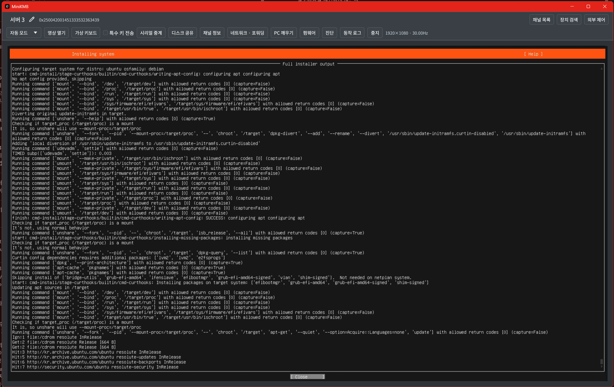
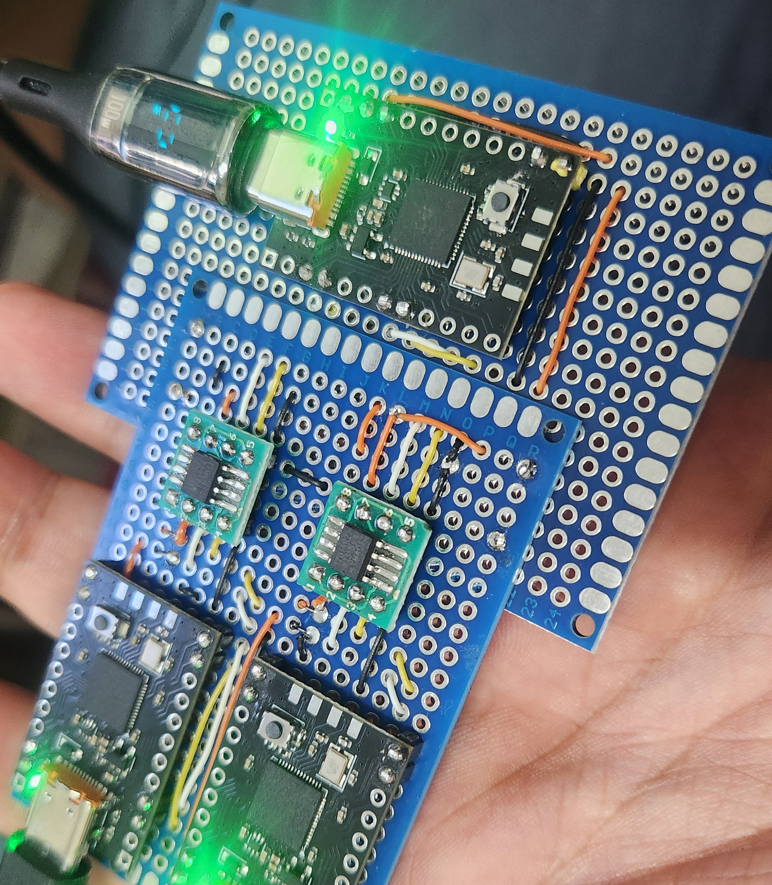
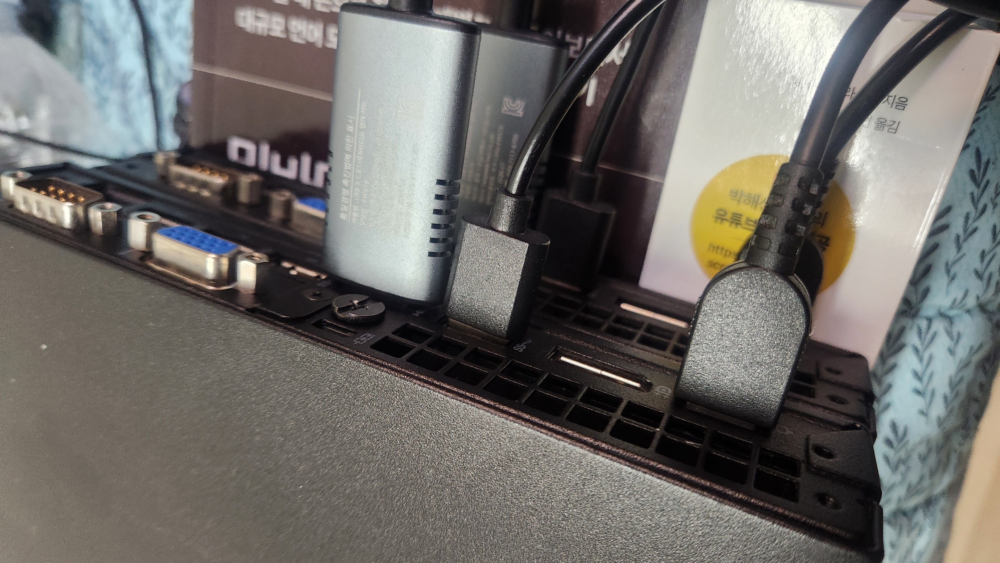
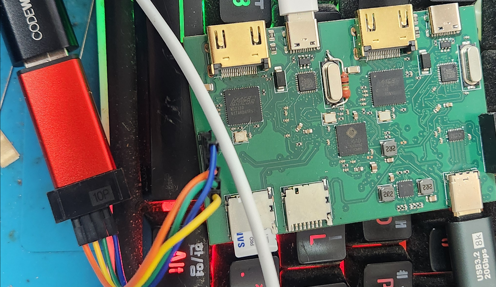
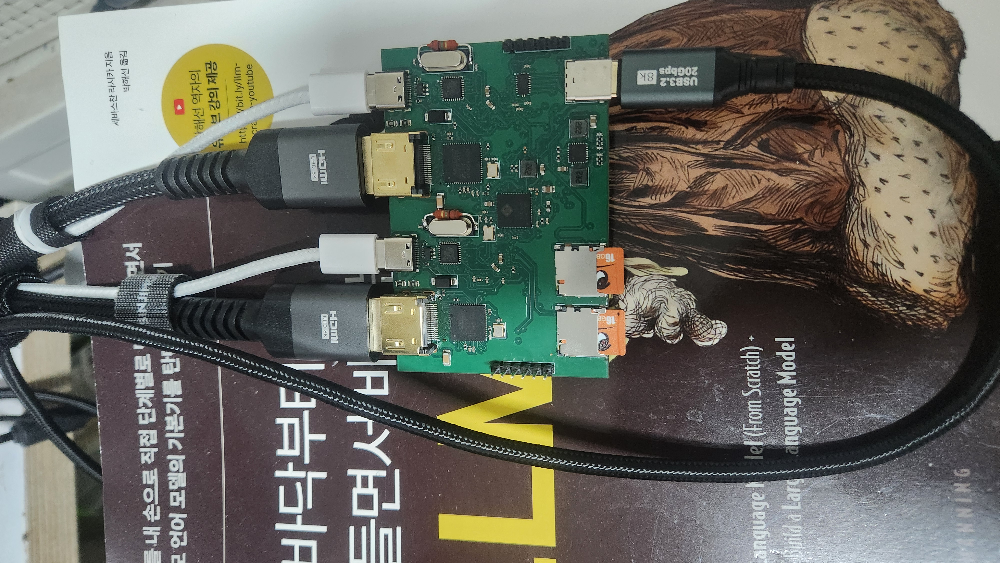
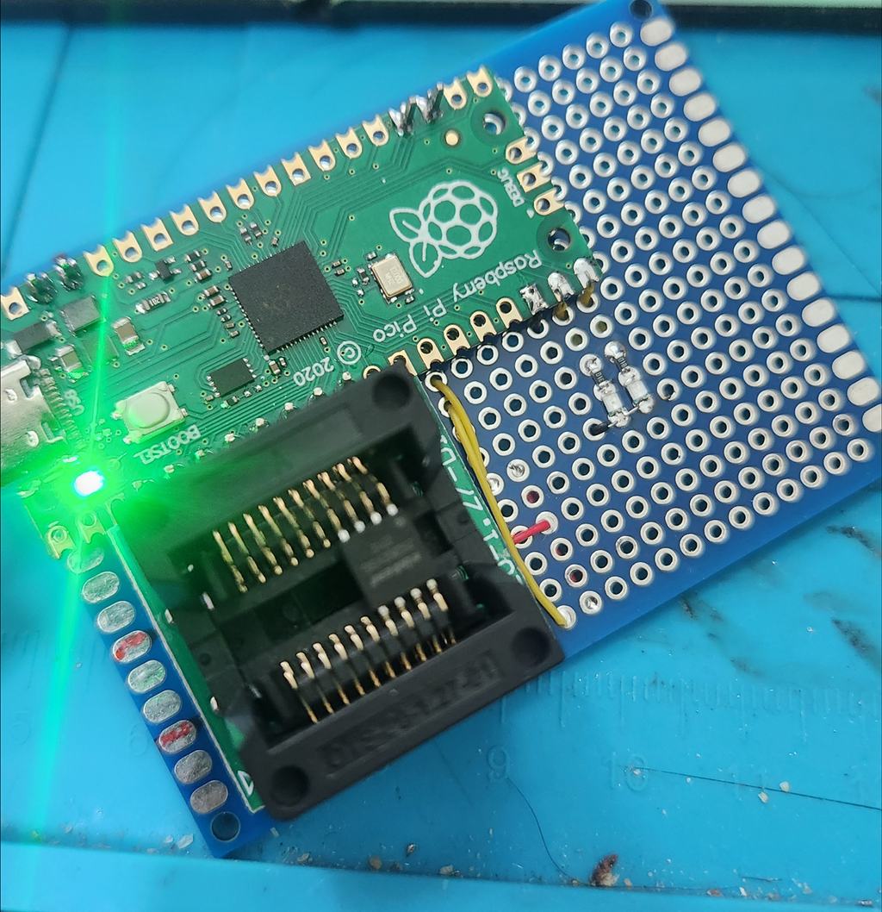
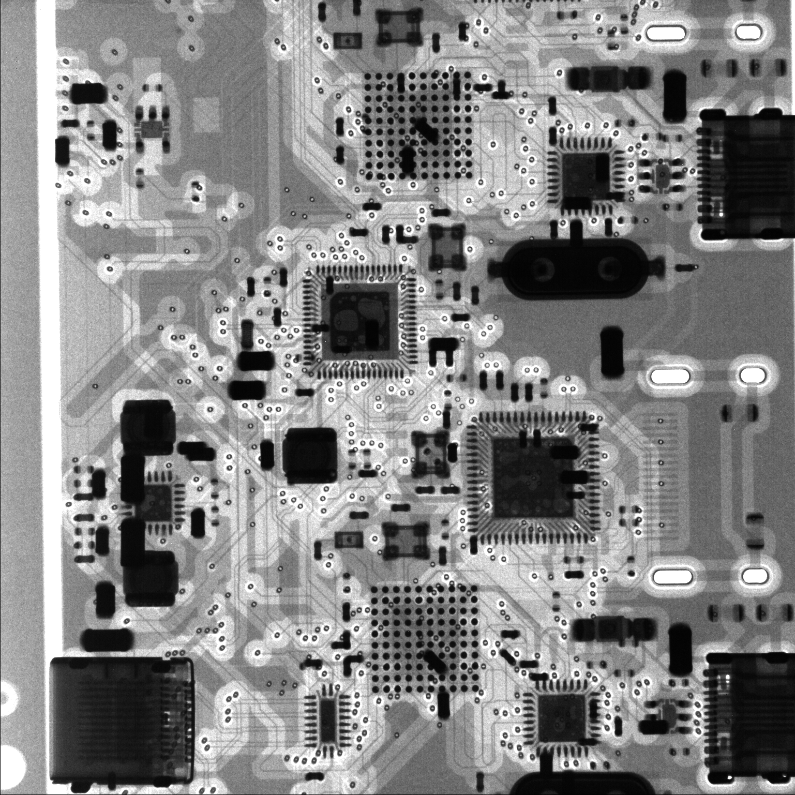
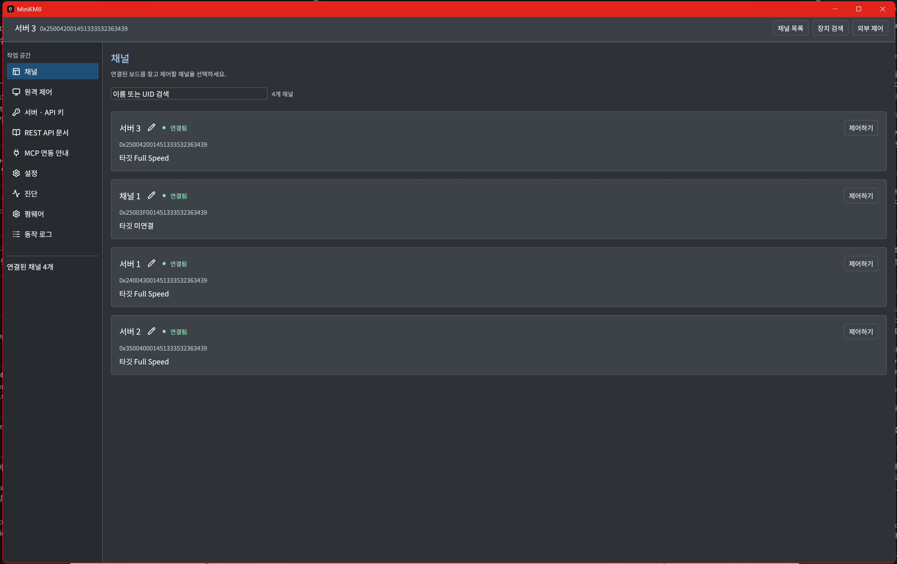
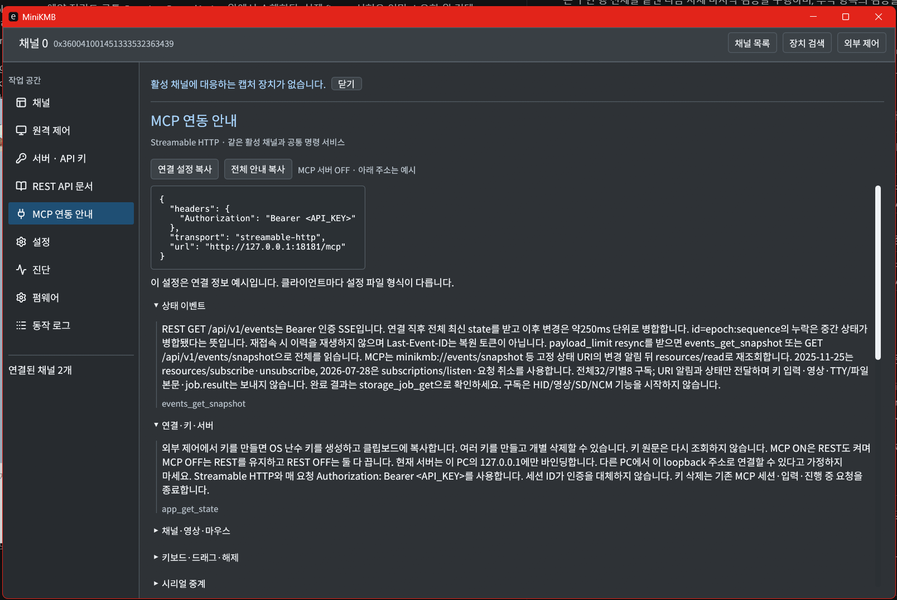

# MiniKMB

[한국어](README.md) · [English](README.en.md)

두 대의 미니 PC를 하나의 관리 PC에서 다루기 위해 제작한 USB KVM 프로젝트입니다. HDMI 영상, 키보드·절대좌표 마우스, 시리얼, 가상 디스크와 네트워크 기능을 함께 제공합니다. RP2040 배선 프로토타입에서 시작해 STM32H7 기반 전용 PCB와 Rust 데스크톱 앱으로 발전했습니다.

[Windows 앱·펌웨어 다운로드](https://github.com/jay94ks/minikmb/releases) · [빌드 안내](docs/BUILDING.md) · [하드웨어와 주의사항](docs/HARDWARE.md) · [References](#references)

## 주요 기능

- 보드당 두 채널을 제공하며 여러 보드를 하나의 앱에서 관리합니다. USB 허브의 고정 포트 관계로 MCU와 MS2130을 자동으로 묶고, MCU와 통신해 읽은 UID를 채널 식별자로 사용합니다.
- 채널 이름 변경·저장, 카드 드래그 정렬, 영상 모드 선택과 한 채널의 영상 제어를 지원합니다.
- 실제 키보드, 가상 키보드, 특수 키, 절대좌표 마우스, 클릭·드래그·휠을 전달합니다.
- SD에 ISO/UDF 설치 이미지와 FAT32·exFAT·EXT4 디스크 이미지를 보관합니다. 광학 드라이브와 쓰기 가능한 가상 디스크, 폴더 전달, 이미지 업로드·생성·포맷을 관리합니다.
- CDC 시리얼, NCM 에뮬레이션·호스트 인터넷/LAN 공유, 포트 포워딩과 타깃 포트 스캐너를 제공합니다.
- ST-Link/SWD를 통한 STM32 플래싱과 RP2040 SPI Writer를 통한 MS2130 ROM 기록을 앱에서 실행합니다. 새 보드의 프로그래밍에 채널 선택이나 기존 MCU UID 등록은 필요하지 않습니다.
- 앱 내 REST 문서와 MCP 연동 안내를 제공합니다. 여러 API 키를 생성·개별 삭제할 수 있으며, 채널 정보·영상 캡처·키보드/마우스·TTY·MSC·NCM을 공통 명령 계층으로 제어합니다.

GUI·REST·MCP 전체에서 **활성 채널은 한 개**입니다. 채널 선택만 UID를 받고, 일반 제어는 현재 활성 채널에 적용합니다. 마우스 API 좌표는 캡처 영상의 픽셀이며 앱이 HID 절대좌표로 변환합니다. MCP를 켜면 REST도 함께 켜지고 REST 단독 실행도 가능합니다. 대용량 파일은 MCP가 알려주는 REST 업로드 끝점으로 전송합니다.

## 시작하기

1. [Releases](https://github.com/jay94ks/minikmb/releases)에서 Windows x64 ZIP을 받아 새 폴더에 풉니다. `tools/`, `firmware/`, 라이선스 파일을 함께 유지하고 `minikmb-native.exe`를 실행합니다.
2. 보드의 관리 USB **J9**를 관리 PC에 연결합니다. 타깃 0은 **J1 HDMI + J3 USB**, 타깃 1은 **J2 HDMI + J4 USB**를 연결합니다. J7/J8은 각 채널의 microSD입니다.
3. 채널 목록에서 **제어하기**를 누릅니다. 여러 보드를 연결해도 한 번에 한 채널의 영상을 엽니다.
4. 필요에 따라 디스크 공유·시리얼·네트워크 기능을 켭니다. REST/MCP와 네트워크 기능은 기본 OFF입니다.

Windows 10/11 x64, DirectX 12와 Media Foundation을 사용하는 미리보기 앱입니다. Visual C++ v14 x64 Runtime이 필요할 수 있습니다. 새 디스크 이미지의 파일시스템 생성은 WSL의 `mkfs`/`fsck` 도구를 사용합니다. 앱 자체 실행에는 Rust·Node.js·Python 설치가 필요하지 않습니다.

현재 배포 펌웨어는 **STM32 v1.0 / FS-HID r63**이며, Rust 앱 패키지 버전은 **0.1.0 preview**입니다. Electron v1.0 소스도 함께 보존합니다. 타깃 USB는 현재 Full Speed(FS)로 제공합니다. 설계자는 USB-C 삽입 방향 감지·신호 선택 회로의 부재와 그에 따른 HS 경로의 임피던스 불일치를, HS 연결이 안정적으로 수립되지 않거나 연결 후 오류율이 높았던 원인으로 판단하고 있습니다. 이 설계 회고와 검증 범위는 [HS 제한 및 설계 회고](docs/KNOWN-ISSUES.md#타깃-usb-hs와-설계-회고)에 정리했습니다. MS2130의 USB 3.x 영상 경로와 MCU의 USB3300/ULPI 경로는 서로 별개입니다. 자세한 범위는 [알려진 제한](docs/KNOWN-ISSUES.md)을 확인해 주세요.

## 문서 언어

공개 안내문서는 [한글 문서](docs/README.md)와 [영문 문서](docs/README.en.md)에서 각각 찾을 수 있습니다. 각 안내문서 상단에서 언어를 전환할 수 있습니다. 프로토콜 상세 명세·소스 주석은 개발 참고자료로 연결하고, 제조사 데이터시트와 외부 라이선스 원문은 원래 언어로 보존합니다.

## 개발 과정과 사진

### RP2040 프로토타입

초기 구성은 관리용 RP2040 한 대와 타깃용 RP2040 두 대를 UART로 연결했습니다. HDMI 영상은 별도의 상용 캡처 케이블 두 개를 사용했습니다. 아래 사진은 수작업 배선 프로토타입과 미니 PC 두 대에 설치해 시험했던 구성입니다.

| RP2040 배선 프로토타입 | 상용 캡처 케이블을 사용한 두 대의 미니 PC 시험 |
|---|---|
|  |  |

### STM32H7 기반 전용 보드

새 버전에서는 STM32H743 두 개, USB3300 PHY 두 개, MS2130 캡처 IC 두 개, USB 허브와 microSD 슬롯을 한 PCB에 통합했습니다. MCU 펌웨어는 TinyUSB·FreeRTOS·FatFs를 이용합니다.

| 디버깅·펌웨어 개발 단계 | 미니 PC 두 대에 연결한 전용 보드 |
|---|---|
|  |  |

### H7 보드를 위한 MS2130 ROM 플래싱 도구와 SMT 검사

왼쪽 도구는 **STM32H7 보드에 탑재한 MS2130을 실제로 동작시키기 위해 제작한 RP2040 기반 SPI ROM Writer**입니다. 초기 KVM 프로토타입과는 역할이 다릅니다. 외부 SPI 플래시에 MS2130 펌웨어를 기록한 뒤 영상 입력이 동작했습니다. 오른쪽은 SMT 조립 공정 이후 촬영한 X-ray입니다. 사진 자체를 보드 전체의 전기적·신호 무결성 검증 결과로 해석하지는 않습니다.

| MS2130용 SPI ROM Writer | SMT 조립 후 X-ray |
|---|---|
|  |  |

### PC 앱

Electron 앱을 바탕으로 Rust·egui 앱을 구현했습니다. 채널을 묶어 관리하고, 선택한 타깃의 영상과 입력·저장소·네트워크를 제어합니다. 아래는 채널 목록과 MCP 연동 안내 화면입니다. 스크린샷은 개발 당시의 장치 상태를 보여 줍니다.

## 저장소 구성

| 위치 | 내용 |
|---|---|
| [`hardware/stm32h7/`](hardware/stm32h7/) | 실제 제작한 6층 PCB·회로도·프로젝트 로컬 라이브러리·Gerber·조립 BOM/CPL |
| [`hardware/rp2040/`](hardware/rp2040/) | 수작업 RP2040 프로토타입 배선 안내 |
| [`hardware/prototypes/`](hardware/prototypes/) | 초기 부품 라이브러리와 미완성 MS2130 단독 시험 보드. 제조용 아님 |
| [`firmware/stm32h7/`](firmware/stm32h7/) | 현재 STM32H743 펌웨어, STM32CubeIDE 프로젝트, 프로토콜·메모리맵·테스트 |
| [`master/`](master/), [`slave/kbm-slave/`](slave/kbm-slave/), [`common/`](common/) | RP2040 관리 브리지·타깃 펌웨어와 공통 프로토콜/호스트 테스트 |
| [`firmware/flash-writer/`](firmware/flash-writer/) | RP2040 SPI Writer 펌웨어와 호스트 도구 소스 |
| [`kbm/`](kbm/) | Electron·Quasar·Vue·TypeScript 앱 |
| [`kbm-rs/`](kbm-rs/) | 현재 Rust·egui·wgpu 앱과 REST/MCP 서버 |
| [`work/`](work/) | 하드웨어 입력을 발생시키지 않는 회귀 테스트와 앱 빌드 보조 도구 |
| [`vendor/`](vendor/) | 고정 라이브러리 원본 아카이브, SDK, GPL 대응 소스와 체크섬 |
| [`references/`](references/) | 사용 칩셋 목록·데이터시트·출처·자료별 권리 고지 |
| [`docs/`](docs/) | 빌드·사용 범위·하드웨어 설명과 개발 사진 |

원래 RP2040 소스의 상대 경로를 유지하기 위해 `master`/`slave`/`common`과 두 앱의 디렉터리 이름을 유지했습니다. 빌드 캐시, 개인 설정·API 키, 장치 캡처 로그, 프롬프트·대화 기록은 공개 소스에 포함하지 않습니다.

## 개발 및 검증

[빌드 안내](docs/BUILDING.md)에 Windows 앱, WSL RP2040, STM32CubeIDE와 포터블 ARM 빌드 절차를 정리했습니다. 하드웨어와 독립적인 테스트는 [테스트 안내](docs/TESTING.md)를 참조해 주세요. 단위 테스트 통과, 펌웨어 빌드, 실제 타깃 동작 확인은 구분합니다.

**회로도는 제작자 jay94ks가 직접 작성했습니다.** 타깃 USB-C의 방향 감지·신호 선택 구성과 HS 경로의 임피던스 조건을 충분히 검토하지 않은 채 PCB 아트웍으로 진행한 것이 이번 설계의 검토 누락이었습니다. 이 문제를 GPT가 회로도를 잘못 작성한 결과로 기록하지 않습니다.

이 프로젝트는 **OpenAI Codex의 GPT 6 Astra와 Sol을 활용하여 개발**했습니다. 제작자가 회로도 작성·하드웨어 제작·연결·납땜·실사용 확인을 수행했으며, 두 모델은 PCB 배치·배선 작업, 펌웨어·앱 구현과 문서화에 활용했습니다.

## 라이선스

직접 작성한 코드와 설계·문서는 [MIT License](LICENSE)로 공개합니다. **아래 외부 구성 요소까지 MIT로 재허가하는 것은 아닙니다.** 원래 저작권·라이선스·예외 조항이 우선하며, 자료별 적용 범위는 [라이선스 고지](NOTICE.ko.md)와 [References](references/README.md)에 정리했습니다.

| 구성 요소 | 적용 조건과 고지 |
|---|---|
| MiniKMB 직접 작성 코드·설계·문서 | MIT. 기존 외부 코드/데이터와 개별 SPDX 고지는 제외 |
| TinyUSB, FreeRTOS | MIT. 원본 LICENSE 보존 |
| Pico SDK, STM32 HAL, CMSIS | SDK/파일별 BSD-3-Clause·Apache-2.0 등 원문 조건 보존 |
| FatFs | ChaN의 원래 저작권 및 허용 고지 보존 |
| Rust·Electron 의존성 | lock 파일로 고정. [원본 아카이브](vendor/README.md)와 각 패키지의 LICENSE/NOTICE, [Windows 앱 의존성 고지](kbm-rs/licenses/THIRD-PARTY.md) 참조 |
| probe-rs | MIT OR Apache-2.0. 앱에서 별도 실행 파일로 호출 |
| flashrom·MS2130 SPI helper | GPL-2.0 계열/파일별 고지. [대응 소스](vendor/flashrom/)와 원래 COPYING 포함. 별도 프로세스로 실행 |
| Noto Sans KR / Lucide | SIL OFL-1.1 / ISC 및 MIT(Feather 유래 부분). [글꼴·아이콘 고지](kbm-rs/assets/fonts/) 참조 |
| KiCad 표준 라이브러리·공급사 유래 형상 | 원래 라이선스와 KiCad 예외/공급사 출처 고지 보존. [CAD 출처](hardware/stm32h7/libraries/README.md) 참조 |
| 데이터시트·칩셋 문서·MS2130 ROM | 제조사/원 저작권자의 권리 유지. MIT 대상 아님. MS2130 ROM의 별도 공개 라이선스는 확인되지 않음 |

프로젝트 사진은 제작자가 공개용으로 제공한 개발 기록입니다. 제품명·상표·화면에 보이는 외부 소프트웨어의 권리는 해당 권리자에게 있습니다.

## References

칩셋 목록과 회로도 참조번호는 [chipsets.csv](references/chipsets.csv), 수집한 원문과 SHA-256은 [데이터시트 목록](references/README.md), 라이브러리 버전·원본은 [vendor/README.md](vendor/README.md)에 있습니다. 다운로드할 수 없었던 자료도 원본 링크와 상태를 남겼습니다.

- **STM32H743** — [ST 데이터시트](https://www.st.com/resource/en/datasheet/stm32h743vi.pdf), [RM0433](https://www.st.com/resource/en/reference_manual/rm0433-stm32h742-stm32h743753-and-stm32h750-value-line-advanced-armbased-32bit-mcus-stmicroelectronics.pdf)
- **USB3300** — [Microchip DS00001783](https://ww1.microchip.com/downloads/aemDocuments/documents/UNG/ProductDocuments/DataSheets/USB3300-Data-Sheet-DS00001783.pdf)
- **MS2130 / GL3510-OSY52 / CH482X** — [수집한 데이터시트와 공급처 출처](references/README.md). 초기 검토용 GL3523 자료는 실제 GL3510 부품과 구분합니다.
- **LM26480 / TUSB321 / XC6220 / USBLC6-2 / W25Q16JV** — [칩셋·전원·보호·SPI 메모리 자료](references/README.md)
- **RP2040 / Pico SDK** — [RP2040 데이터시트](https://datasheets.raspberrypi.com/rp2040/rp2040-datasheet.pdf), [Pico SDK](https://github.com/raspberrypi/pico-sdk)
- **TinyUSB / FreeRTOS / FatFs / CMSIS / STM32 HAL** — [hathach/tinyusb](https://github.com/hathach/tinyusb), [FreeRTOS-Kernel](https://github.com/FreeRTOS/FreeRTOS-Kernel), [FatFs](https://elm-chan.org/fsw/ff/), [CMSIS](https://github.com/ARM-software/CMSIS_5), [STM32H7 HAL](https://github.com/STMicroelectronics/stm32h7xx-hal-driver)
- **PC 앱** — [egui/eframe](https://github.com/emilk/egui), [wgpu](https://github.com/gfx-rs/wgpu), [Tokio](https://tokio.rs/), [Axum](https://github.com/tokio-rs/axum), [Rust MCP SDK](https://github.com/modelcontextprotocol/rust-sdk), [smoltcp](https://github.com/smoltcp-rs/smoltcp), [Electron](https://www.electronjs.org/), [Quasar](https://quasar.dev/), [Vue](https://vuejs.org/)
- **플래싱 도구** — [probe-rs](https://github.com/probe-rs/probe-rs), [flashrom](https://github.com/flashrom/flashrom)
- **PCB 제작 검토** — [JLCPCB capabilities](https://jlcpcb.com/capabilities/pcb-capabilities), [임피던스 계산기](https://jlcpcb.com/pcb-impedance-calculator). 저장된 스택업·제조 조건은 [하드웨어 안내](docs/HARDWARE.md) 참조
