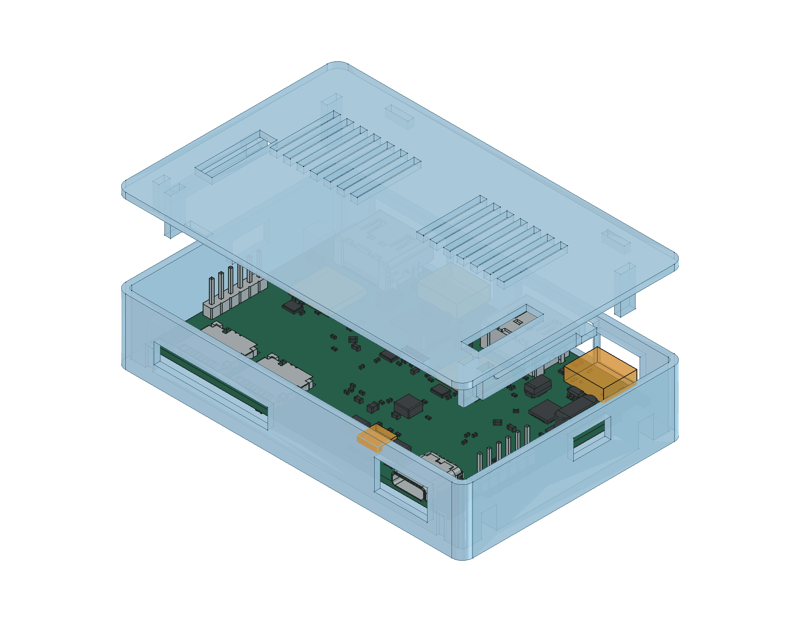

# MiniKMB clear snap-fit enclosure

[한국어](README.md) · [English](README.en.md)

A FreeCAD enclosure for the 80 × 54 mm STM32H7 MiniKMB PCB. Print one base and one lid. Push down to close; press the two side latches inward to lift the lid. **No screws, nuts, separate clips or adhesive are required.**

**Prototype design: digital checks passed; printing, physical fit, latch force, repeated opening, temperatures and JLC3DP manufacturing approval have not been verified.**

## Files and ordering

- **[JLC3DP STL ZIP](output/JLC3DP_STL.zip)** — extract and upload the two STL files separately.
- [Base STL](output/01_Base.stl) / [lid STL](output/02_Lid.stl)
- [Base STEP](output/01_Base.step) / [lid STEP](output/02_Lid.step)
- [Editable FreeCAD document](output/MiniKVM_Clear_Snap_Case.FCStd)
- [Validation report](output/validation.json) / [SHA-256 manifest](output/SHA256.json)

Suggested settings: **SLA / 8001 / Transparent / natural clear**, one base and one lid, **mm / 1:1**. Upload either STEP or STL for each part, not both as duplicate orders. Do not manufacture the PCB reference STEP or the complete FCStd assembly. The manufacturer determines build orientation and supports.

The 8001 Transparent material page includes sanding and oil spraying by default. Small bubbles and surface texture remain possible; optical clarity is not guaranteed. Translucent is a different appearance and should not be substituted automatically. Omit optional dye, paint and decorative finishing.

Suggested order note:

> Two separate snap-fit electronic enclosure parts: one base and one lid. SLA 8001 transparent, natural clear, no dye. Units mm, scale 1:1. The lid includes two integral long flexible release latches; do not fuse the latch clearance spaces. Preserve hook ramps, receiver windows, connector openings and mating surfaces. Please review whether the 8001 material and finishing process can produce the latches without damage. Advise before dimensional changes. No PCB/reference model is included for manufacture.

No quote, upload, manufacturing approval, order or payment has been completed. Official references checked on 2026-11-28: [8001 specifications](https://jlc3dp.com/help/article/photosensitive-8001-resin), [design guidelines](https://jlc3dp.com/help/article/3d-printing-design-guideline), [file formats and ordering](https://jlc3dp.com/help/article/how-to-place-a-3d-printing-order). Price depends on volume, material, quantity, finishing, manufacturing review and shipping.

## Dimensions and assembly

| Item | Nominal design |
|---|---|
| Assembled exterior | 93 × 59.6 × 19.2 mm |
| Wall, floor and lid | 1.6 mm |
| Exterior corner radius | 2.8 mm |
| Printed parts | One base and one lid with integral latches |
| Resin volume | About 24.04 cm³ |
| Volume comparison | About 14.1% below the same exterior/features with 2.4 mm sheets/walls |
| Latches | Two; 26 mm long, 1.6 mm flex thickness, 3 mm depth, R1 root blend |
| Hook engagement / vertical play | 0.8 / 0.4 mm nominal |

Volume savings are not a quotation discount. There are no screw bosses, printed threads, separate covers, hinges or sealed hollow cavities. Four end tabs align the lid. The long side beams flex inward while the sloped noses cross the rim and enter the release windows.

The PCB has components on both faces and no mounting holes. Four seats touch bare PCB edges only: X=0…1.5 / 78.5…80 mm combined with Y=4…8 / 46…50 mm, measured from the PCB's lower-left corner with X right and Y up. The PCB underside is 5.5 mm above the case bottom. Lid keeper clearance above the PCB is 0.6 mm; lateral clearance is 0.5 mm. The PCB is not clamped tightly.

Openings serve two HDMI inputs, two target USB-C ports, management USB-C, shared finger access to both microSD slots, and both SWD headers. Fourteen upper vents sit over the hot components. Rubber feet are optional.

1. Seat the board and check that the seats do not touch components or solder joints.
2. Align the lid and SWD openings; press gently near both latch locations.
3. Confirm that both hooks return into their side windows.
4. To open, press both hooks inward through the side windows and lift vertically. Do not pry through connector openings.

For a roughly 24 mm effective cantilever and 1.4 mm deflection, the small-deflection surface strain estimate is about 0.58%. This is not FEA, a strength/fatigue acceptance or a service-life test. The material's 53°C heat-deflection temperature is not a continuous enclosure operating rating. Check force, recovery, repeated opening and operating temperatures on the first print.

## Validation and remaining work

The source is [`../stm32h7/MiniKMB.kicad_pcb`](../stm32h7/MiniKMB.kicad_pcb), manufactured revision `20261104-via030`, SHA-256 `05421c8b5b211a30ea6a57813909a3ad836e9fca3ae9b78bab4d1696b7d1fce8`, configured thickness 1.5584 mm. No PCB or firmware changes were made.

FreeCAD 1.1.4 checks passed: valid closed single solids; zero base/lid and PCB/reference-envelope volume intersections; zero interference in the space needed for 1.4 mm inward latch motion; no footprint-boundary conflicts at the PCB contact areas; closed manifold STL meshes; STEP reload with matching volume; final GUI-saved FCStd reopen/recompute with matching volumes; ZIP CRC and file hashes.

Eight missing STEP models—U4/U13/J4/U3/J3/U15/Y9/Y6—are shown as amber conservative courtyard/height boxes. They do not replace real component geometry. **Actual J3/J4 USB-C height/projection, cable overmolds, SD ejection, SWD cable housing, latch retention/release force, durability and loaded operating temperatures remain unverified.**

## Editing and rebuilding

Edit the `Parameters` spreadsheet's B column. Standard Part primitives, Boolean history and latch Sketch/Extrusion objects require no custom plugin. Port, contact and latch positions also need review if the PCB dimensions change.

Run `python build_case.py` using a Python interpreter that can import the FreeCAD modules; Windows FreeCAD installations provide `bin/python.exe`. After it finishes, execute `Preview.FCMacro` in FreeCAD to save display settings and CAD previews. Then run `python verify_delivery.py` in the same FreeCAD Python environment.

Use KiCad 10's `pcbnew` Python environment for `inspect_board.py`; the default input is the repository's STM32H7 PCB, or pass another path as the first argument. The included `board-reference.step` was exported by KiCad 10 using `pcb export step --subst-models --user-origin 169.615x133.01mm`. Update reference envelopes and checks if the available component models change.

## License and attribution

The original case design, scripts and documentation use the repository's [MIT License](../../LICENSE). The PCB reference STEP and PCB/component geometry embedded in FCStd include KiCad-derived library geometry; these are not exclusively claimed as MiniKMB-authored works or relicensed wholesale under MIT. Preserve the existing [CAD attribution](../stm32h7/libraries/README.md) and [KiCad license and exception](../stm32h7/libraries/KiCad-LICENSE.md).
