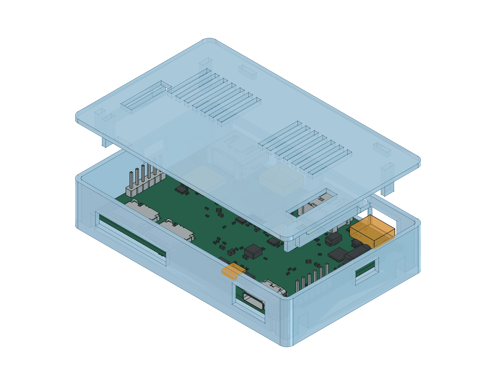

# MiniKMB 투명 맞물림 케이스

[한국어](README.md) · [English](README.en.md)

80 × 54 mm STM32H7 MiniKMB 보드용 FreeCAD 케이스다. 하판과 덮개 두 개를 출력해 위에서 눌러 잠그고 양옆 걸쇠를 눌러 연다. **나사·너트·별도 클립·접착제가 필요 없다.**

**시제품 설계다. 디지털 형상 검증은 통과했지만 실제 인쇄·조립·반복 개폐·발열과 JLC3DP 제조 승인은 아직 확인하지 않았다.**



## 다운로드와 주문

- **[JLC3DP 주문용 STL ZIP](output/JLC3DP_STL.zip)** — 압축을 풀면 하판·덮개 STL 두 파일만 나온다.
- [하판 STL](output/01_Base.stl) / [덮개 STL](output/02_Lid.stl)
- [하판 STEP](output/01_Base.step) / [덮개 STEP](output/02_Lid.step)
- [편집 가능한 FreeCAD 원본](output/MiniKVM_Clear_Snap_Case.FCStd)
- [검증 결과](output/validation.json) / [SHA-256](output/SHA256.json)

JLC3DP에서 **SLA / 8001 / Transparent(무색 투명)**을 선택하고 하판·덮개를 **각각 1개**, **mm / 1:1**로 업로드한다. 같은 부품의 STEP와 STL을 중복 주문하지 않는다. PCB 참고 모델과 FCStd 조립 전체는 주문하지 않는다. 최종 조형 방향과 서포트 배치는 제조사가 결정한다.

8001 Transparent는 공식 안내상 기본 샌딩·오일 스프레이가 적용된다. 작은 기포나 표면 무늬가 남을 수 있으며 광학 투명도를 보장하지 않는다. Translucent는 반투명 결과이므로 자동 대체하지 않는다. 별도 염색·도색·장식 마감은 제외한다.

주문 메모 예시:

> Two separate snap-fit electronic enclosure parts: one base and one lid. SLA 8001 transparent, natural clear, no dye. Units mm, scale 1:1. The lid includes two integral long flexible release latches; do not fuse the latch clearance spaces. Preserve hook ramps, receiver windows, connector openings and mating surfaces. Please review whether the 8001 material and finishing process can produce the latches without damage. Advise before dimensional changes. No PCB/reference model is included for manufacture.

실제 견적·업체 업로드·주문·결제는 수행하지 않았다. [소재 사양](https://jlc3dp.com/help/article/photosensitive-8001-resin), [설계 가이드](https://jlc3dp.com/help/article/3d-printing-design-guideline), [지원 파일 형식과 주문 방법](https://jlc3dp.com/help/article/how-to-place-a-3d-printing-order)은 2026-11-28에 확인했다. 가격은 체적·소재·수량·마감·제조 검토·배송에 따라 달라진다.

## 치수와 구조

| 항목 | 설계값 |
|---|---|
| 조립 외형 | 93 × 59.6 × 19.2 mm |
| 벽·바닥·덮개 | 기본 1.6 mm |
| 외곽 모서리 | R2.8 mm |
| 부품 | 하판 1개 + 일체형 걸쇠 덮개 1개 |
| 레진 체적 | 약 24.04 cm³ |
| 체적 비교 | 동일 외곽·기능의 2.4 mm 두께안 대비 약 14.1% 절감 |
| 걸쇠 | 좌우 각 1개, 길이 26 mm, 굽힘 두께 1.6 mm, 깊이 3 mm, 뿌리 R1 |
| 걸쇠 물림 / 수직 여유 | 명목 0.8 / 0.4 mm |

체적 절감률은 가격 절감률이 아니다. 나사 기둥, 인쇄 나사산, 별도 캡·경첩과 폐쇄 중공 구조를 넣지 않았다. 긴 걸쇠가 안쪽으로 휘며 경사 코를 넘어 측면 창에 복귀한다. 전후 탭 네 개가 덮개를 정렬한다.

PCB에는 체결 구멍이 없고 양면에 부품이 있어 맨 기판 가장자리 네 곳만 받친다. PCB 좌하단을 (0,0), X 오른쪽·Y 위쪽으로 할 때 접촉 구간은 X=0…1.5 / 78.5…80 mm와 Y=4…8 / 46…50 mm의 조합이다. 기판 밑면은 케이스 바닥에서 5.5 mm 위에 놓인다. 덮개 제한 돌기와 PCB 윗면의 여유는 0.6 mm, PCB 측면 여유는 0.5 mm다. 기판을 강하게 압착하지 않는다.

HDMI 2개·타깃 USB-C 2개·관리 USB-C 1개, microSD 두 개 공용 손가락 창, SWD 두 개 상부 서비스 창과 통풍 슬롯 14개를 포함한다. 고무발은 선택 사항이다.

## 조립과 분리

1. PCB를 하판의 네 가장자리 좌대에 놓고 부품·납땜과 닿지 않는지 확인한다.
2. 덮개 방향과 SWD 창을 맞추고, 양쪽 걸쇠 부근을 가볍게 눌러 잠근다.
3. 두 걸쇠가 측면 창으로 복귀했는지 확인한다.
4. 열 때는 양옆 창 안의 걸쇠를 안쪽으로 누르면서 덮개를 수직으로 들어 올린다. 포트 창에 지렛대를 넣어 벌리지 않는다.

투명 레진의 걸쇠는 첫 시제품에서 체결력·복귀·반복 개폐를 확인해야 한다. 유효 길이 약 24 mm, 변위 1.4 mm의 단순 외팔보 표면 변형률 추정은 약 0.58%다. 이 값은 FEA·파단·피로·수명 시험 결과가 아니다. 8001의 열변형 온도 53°C도 케이스 연속 사용 허용 온도를 뜻하지 않는다.

## 검증 범위

대상은 [`../stm32h7/MiniKMB.kicad_pcb`](../stm32h7/MiniKMB.kicad_pcb), 발주 리비전 `20261104-via030`이다. 원본 SHA-256은 `05421c8b5b211a30ea6a57813909a3ad836e9fca3ae9b78bab4d1696b7d1fce8`, 설정 기판 두께는 1.5584 mm다. PCB와 펌웨어는 수정하지 않았다.

FreeCAD 1.1.4에서 다음을 통과했다.

- 하판·덮개 각각 유효한 폐쇄 단일 솔리드.
- 하판/덮개 상호 간섭과 PCB STEP·누락 부품 대체 공간과의 체적 교차 0.
- 걸쇠 변위 1.4 mm에 필요한 공간의 PCB·하판 간섭 0.
- 기판 접촉 구간과 모든 풋프린트 XY 경계의 충돌 0.
- STL 닫힘·비다양체 없음, STEP 재로딩 후 단일 솔리드·체적 일치.
- 최종 FCStd GUI 저장 후 재개방·재계산·솔리드 체적 일치, ZIP CRC·파일 해시 검증.

STEP에서 누락된 U4/U13/J4/U3/J3/U15/Y9/Y6 8개는 풋프린트 경계와 보수적 높이의 황색 직육면체로 표시했다. 실제 부품 형상의 검증을 대신하지 않는다. **J3/J4 USB-C 실제 높이·돌출, 케이블 외피, SD 배출 동작, SWD 케이블 하우징, 걸쇠 체결력·내구, 동시 부하 발열은 실물 확인이 남아 있다.**

## 편집과 재생성

`Parameters` 시트 B열에서 주 치수를 편집할 수 있다. 프리미티브와 Boolean 이력, 걸쇠 Sketch/Extrusion은 표준 FreeCAD 객체이며 전용 플러그인이 필요 없다. 보드 외곽을 변경하면 고정된 포트·접촉·걸쇠 좌표도 검토한다.

FreeCAD Python 모듈을 가져올 수 있는 환경에서 다음을 순서대로 실행한다. Windows 설치판의 `bin/python.exe`를 사용할 수 있다.

```text
python build_case.py
```

종료를 확인한 뒤 FreeCAD에서 `Preview.FCMacro`를 실행해 표시 속성과 실제 CAD 미리보기를 저장한다. 이후 같은 FreeCAD Python 환경에서 실행한다.

```text
python verify_delivery.py
```

`inspect_board.py`는 KiCad 10의 `pcbnew`를 가져올 수 있는 Python으로 실행한다. 기본 입력은 저장소의 STM32H7 PCB이며 다른 경로는 첫 인자로 지정한다. 포함한 `board-reference.step`은 KiCad 10 STEP 출력이다. 다시 출력할 때 원점은 `--user-origin 169.615x133.01mm`, 옵션은 `pcb export step --subst-models`를 사용한다. 누락 모델이 달라지면 대체 공간과 검증도 갱신한다.

## 라이선스와 출처

직접 작성한 케이스 형상·스크립트·문서는 저장소의 [MIT License](../../LICENSE)를 따른다. PCB 참고 STEP와 FCStd 안의 PCB·부품 참고 형상에는 KiCad 표준 라이브러리 유래 형상이 포함되어 있으며 이를 독점적인 MiniKMB 저작물로 주장하거나 일괄 MIT로 재허가하지 않는다. 기존 [CAD 출처와 라이선스 고지](../stm32h7/libraries/README.md), [KiCad 라이선스·예외 원문](../stm32h7/libraries/KiCad-LICENSE.md)을 함께 따른다.
