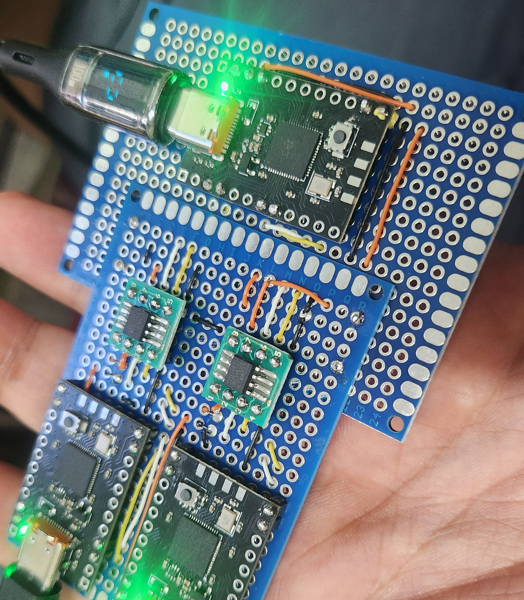
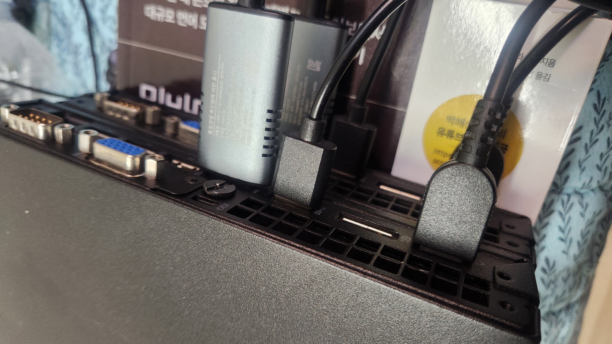

# RP2040 hand-wired prototype

The prototype used one USB management master and two target slaves, with UART links and separate commercial HDMI capture cables. This was a hand-wired perfboard assembly, not a fabricated MiniKMB PCB. No fabricated RP2040 schematic/PCB file is invented for this archive.

- Master: USB CDC ↔ dual UART, source `../../master/`.
- Slaves: UART ↔ USB HID/CDC/NCM and optional MSC, source `../../slave/kbm-slave/`.
- 921600 baud, 8-N-1. Master UART0 GP0 TX / GP1 RX; UART1 GP4 TX / GP5 RX. Slave UART0 GP0 TX / GP1 RX. Connect TX to the opposite RX; follow the actual isolation/power domains used in your build.
- ADuM1201ARZ was used for UART isolation. Its grade limits must be respected; do not raise the operating baud based on unrelated faster grades.
- Keep `PICO_XOSC_STARTUP_DELAY_MULTIPLIER=48` for the custom boards.
- GPIO25 indicates USB availability. No connected VBUS_DET is assumed.
- Master VID:PID `8857:1223`; slave `8857:1222`. USB IDs are project/prototype values, not an allocation of third-party VID rights.

